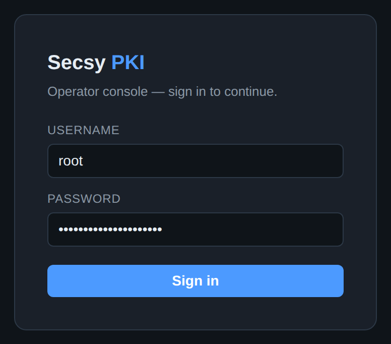

# A walkthrough of the operator console

[The web console reference](web-console.md) lists every page and the endpoints
behind it. This page does something different: it walks the console in the order
you actually meet it, from an empty deployment to one issuing, revoking and
proving things — and shows each step.

That order is the one thing worth knowing before you begin. **A PKI is built
root-first and torn down leaf-first.** Until a certificate authority exists
there is nothing to issue under, nothing to revoke, no CRL to publish and no
chain to validate; most of the console's pages are empty or refuse to act. So
the walk starts at Authorities, not at Certificates — even though Certificates
is the tab the console opens on, because that is where you spend the rest of
your life.

- [Before you start](#before-you-start)
- [1. Signing in](#1-signing-in)
- [2. Build the hierarchy](#2-build-the-hierarchy)
- [3. Prove where the keys are](#3-prove-where-the-keys-are)
- [4. Issue a certificate](#4-issue-a-certificate)
- [5. Dry-run it first](#5-dry-run-it-first)
- [6. The issued estate](#6-the-issued-estate)
- [7. When a key is compromised](#7-when-a-key-is-compromised)
- [8. What breaks next](#8-what-breaks-next)
- [9. Across every CA](#9-across-every-ca)
- [10. Prove a chain](#10-prove-a-chain)
- [11. What a relying party needs](#11-what-a-relying-party-needs)
- [12. The other CA: SSH](#12-the-other-ca-ssh)
- [13. Signing artifacts](#13-signing-artifacts)
- [14. The other half: secrets](#14-the-other-half-secrets)
- [15. The stored-secret registry](#15-the-stored-secret-registry)
- [16. The audit log](#16-the-audit-log)
- [17. Delegating one CA](#17-delegating-one-ca)
- [18. Machine callers](#18-machine-callers)
- [19. Compliance evidence](#19-compliance-evidence)
- [20. Day-2 diagnostics](#20-day-2-diagnostics)
- [21. What is actually on the token](#21-what-is-actually-on-the-token)
- [Where to go next](#where-to-go-next)

The screenshots are of a throwaway PKI belonging to an invented company,
*Northwind Logistics GmbH*, under `.example` names, rebuilt from scratch by
`scripts/screenshots/capture.sh` and destroyed afterwards — so every serial,
subject and audit entry in them is one the product generated for the picture,
and none of it is anyone's. Every certificate was signed by a key generated
inside a SoftHSM token; the CRLs are real CRLs and the audit log is a real hash
chain. [Why it is done this way](../../scripts/screenshots/README.md).

---

## Before you start

The console is served by the server itself, at `/console/`, out of the binary —
there is no separate front-end to deploy, and nothing extra to turn on:

```bash
secsy-pki-server -config config.yaml
# → https://pki.example.internal:8443/console/
```

It holds no privileges of its own. Every button on every page calls the same
RBAC-gated, audited REST API that `secsy-ca` calls, with your credentials
attached, so **the console can do exactly what you can do and nothing more** —
and everything it does lands in the audit log under your name. That is also why
this walkthrough is useful even if you intend to script everything: the pages
map one-to-one onto commands, and the
[parity matrix](cli-console-parity.md) names the mapping.

---

## 1. Signing in



The form tries, in order, the authentication methods the server has configured:
a directory (LDAP/AD) bind, then the built-in `root` password. Both establish a
**server-side session with a CSRF token**, which is what lets the console offer
WebAuthn step-up on high-risk operations later. With OIDC configured, a *Sign in
with SSO* button appears below the divider — under a line naming the protection
the redirect will use, "OpenID Connect Authorization Code flow with PKCE (S256)",
read from the server's own [discovery document](../security/authentication.md#pkce)
rather than asserted by the page — and the password form stays for break-glass.
With [several identity providers](../security/authentication.md#multiple-oidc-providers)
configured, that becomes one button per provider — *Sign in with Microsoft Entra
ID*, *Sign in with Okta* — so an operator picks their own IdP.

**The `root` account in the screenshot is the one to plan to stop using.** It is
a shared password with full authority over every tenant, it exists so a brand-new
deployment can be administered at all, and it is the obvious thing to find in a
breach. Once real operators can sign in — through OIDC, LDAP, or client
certificates — set `policy.allow_root_basic_auth: false` and it is gone. The
options and the trade-offs are in
[operator authentication](../security/authentication.md).

---

## 2. Build the hierarchy


**Authorities** is the hierarchy, and it is the first page that matters. Each
row is a CA: its label (which is also its key label on the token), its subject,
the key the HSM holds for it, whether it is a root or an intermediate, and how
long it has left.

The shape above is the one to copy. **One offline-ish root with a long life,
several short-lived intermediates underneath it, one per purpose.** Splitting by
purpose — public TLS, device fleet, platform workloads — is not bureaucracy: an
intermediate is the unit you can rotate, constrain and revoke independently, so
a compromised device-enrollment key costs you the device fleet rather than the
company. The root signs three certificates in its life and otherwise does
nothing.

**Rotate key** starts a [dual-chain rollover](../ca/rotation.md): the CA gets a
new signing key while the old one keeps serving its already-issued certificates
through an overlap window, so nothing breaks at the moment of the swap. There is
no button that destroys a key in one click.


Below the table are the three ways a CA comes into existence, and which one you
want depends on who owns the trust anchor:

| Form | Use it when |
| --- | --- |
| **Create root CA** | this PKI is its own trust anchor — an internal/private PKI |
| **Issue intermediate CA** | the parent is a CA this deployment already holds |
| **External subordinate CA (CSR)** | the parent is an **offline corporate root or a third party**; you get a key and a CSR, they return a certificate ([details](../ca/external-ca.md)) |

Two fields deserve a decision rather than a default. **Key type** is the one
thing you cannot change later without re-issuing everything beneath it —
`ecdsa-p384` for a root, `ecdsa-p256` for issuers, RSA only when a client in
your estate still cannot do better. And **path length** `0` on an intermediate
means *this CA may issue leaves and no further CAs*, which is the constraint
that stops an issuing CA from quietly becoming a parent. Set it.

Whichever form you use, **the private key is generated inside the token and is
never in the server's memory**. There is no form here that accepts one, because
there is no code path that would do anything with it. (Adopting a CA that
already exists elsewhere is a deliberate, separate operation —
[importing an existing CA](../ca/import.md).)

---

## 3. Prove where the keys are


This panel, at the bottom of the same page, is the product's central claim made
checkable. For every key on the provider it reports the two PKCS#11 attributes
that decide whether "HSM-backed" means anything:

- **`CKA_EXTRACTABLE = false`** — the token will not export this key, wrapped or
  otherwise. The column reads **NO**, and that is the answer you want.
- **`CKA_SENSITIVE = true`** — the token will not reveal the key's value to an
  application, even to the one that created it.

A key showing `yes` under Extractable is a key that could leave, and the summary
line counts them so a single bad one cannot hide in a long list. The *not bound
to a CA* count is not a warning: the KEK, the timestamping key and the
code-signing key are legitimately not CA keys.

**This is an inventory, not a proof.** It reports what this token says about
itself, which is exactly as trustworthy as the token. On a YubiHSM you can go
further and get a certificate, signed by a key Yubico put in the device at
manufacture, attesting that a named key was generated on-device and cannot be
exported — see [key attestation](../hsm/key-attestation.md). On SoftHSM, as
here, there is no such hardware claim to make, and that is the honest difference
between a development token and an HSM.

---

## 4. Issue a certificate


Issuance takes a CSR, a CA and a **profile** — and the profile is the part worth
understanding, because it is where policy lives rather than in the request.

A profile fixes the key usages, the extended key usages, the maximum validity
and which per-request overrides are even offered. The grey **profile policy**
line under the pickers is that policy, restated for the profile you just chose,
before you submit anything: 397 days maximum, `digitalSignature` and
`keyEncipherment`, `serverAuth`. A request asking for more is refused; a request
asking for less gets less.

This is also why the form changes shape as you pick: a UPN field appears only
for smartcard-logon profiles, an OCSP Must-Staple override only where the
profile permits one, a PSD2 authorization group only on a qualified profile.
**Controls that would be rejected are not rendered**, so the form cannot be used
to build a request the gates will throw away.

Note what the form does *not* take: a private key. The subject generates its own
key and sends a CSR. (When the subject genuinely cannot — a device enrolling
by hand, an S/MIME recipient — the **PKCS#12** page generates a key server-side
and hands back a password-protected bundle, which is a different trade-off,
deliberately on a different page.)

---

## 5. Dry-run it first


**Preview (dry run)** runs the entire pre-issuance gate stack and stops short of
the signature. No serial is allocated, no audit event is written, the HSM is
never asked for anything. The result is the certificate that *would* exist and
the verdict of every gate that would have had to pass.

Read it as two halves. The top is the **resolved leaf** — what the profile and
your request combined to, including the fields you did not supply. The bottom is
the **gate ledger**, and `SKIPPED` there is as informative as `PASS`: *"CAA gate
disabled for the profile"* and *"issuing CA imposes no name constraints"* are
each telling you a control is not in force, which is sometimes the finding.

Use it in the two situations where issuing to find out is expensive: when you
have just changed a profile and want to know what it now does, and when a
request is being refused and the error alone does not say which of a dozen
gates refused it. `secsy-ca issue -dry-run` is the same thing from a terminal;
the full gate list is in [pre-issuance preview](../issuance/preview.md).

---

## 6. The issued estate

![The Certificates view for northwind-issuing-tls: filter controls for search, status and profile, Download CRL and Delta CRL links, a CRL freshness strip reading "CRL #2 · 2 revoked · updated 2026-10-18 10:30Z · next 2026-10-25 10:35Z | delta #3 (base #2) · 0 entries · next 2026-10-18 11:35Z | partitioned into 2 shards: 0 1", and a table of thirteen certificates with serial, common name, profile, not-after and status — mostly VALID, one HELD with a Release button, one REVOKED with no action buttons, and Renew / Suspend / Revoke on the rest.](../screenshots/07-certificates.png)

This is the page you live on. One CA at a time, server-side filtered and paged —
the table is keyset-paginated with a **Load more** action rather than loading an
estate of a hundred thousand certificates into a browser tab.

**The strip above the table is the CRL, and it is the part operators forget to
look at.** It names the current CRL number, how many entries it carries, when it
was regenerated and — the one that matters — **when it next will be**. A relying
party that fetches a stale CRL fails open or fails closed depending on its own
configuration, neither of which you chose. If `next` is in the past, revocation
is not being published and that is an incident, not a cosmetic issue. The delta
CRL and the per-shard links are beside it, for the estates large enough to need
[partitioned CRLs](../ca/overview.md).

The per-row actions are the lifecycle, and the distinction between two of them is
the one to get right:

- **Revoke** is permanent. RFC 5280 gives no way back, and the reason code you
  pick is published to every relying party. Choose it deliberately —
  `keyCompromise` is a statement about the subject's key, `superseded` and
  `cessationOfOperation` are statements about the service.
- **Suspend** places the certificate on hold (`certificateHold`) and is
  **reversible**: the row gains a **Release** button, which emits `removeFromCRL`
  in the next delta CRL and returns it to service. Reach for this when you
  suspect rather than know — a host that has stopped responding, a laptop
  reported missing an hour ago.
- **Renew** issues a replacement with a fresh serial, leaving the old one in
  place and valid until it expires. It is not an edit; both exist. (The two
  `depot-fra.northwind.example` rows above are exactly that — a renewal and its
  predecessor.)

---

## 7. When a key is compromised

![The Bulk revocation — incident response panel, outlined in red: filter fields for profile, a CN/SAN glob set to *.fleet.northwind.example, issued-after and issued-before dates, a reason picker set to keyCompromise, an optional serial-list textarea, and a completed dry run reading "5 certificate(s) will be revoked (reason keyCompromise, filter: pattern=*.fleet.northwind.example)" above a sample of the five matching scanner and telematics certificates, then a field labelled "Type the certificate count to confirm (5)" and a Revoke certificates button.](../screenshots/08-bulk-revocation.png)

Revoking one certificate is a button. Revoking the certificates of an entire
device fleet, against the CA/Browser Forum's 24-hour clock, at three in the
morning, is where mistakes get made — so this panel is built to be slow in
exactly one place.

The selection is a filter: profile, a CN/SAN glob, an issuance window, and
optionally a pasted list of serials (including **serials the inventory has never
seen**, which is how you revoke certificates an attacker issued with a stolen
CA key — they go onto the CRL as bare entries).

Then the contract. **Preview (dry run)** reports the count and a sample, and
nothing happens. To proceed you must **type that exact count** into the
confirmation field. A filter that matched 4,000 certificates when you expected
5 cannot be executed by muscle memory, because the number you have to type is
the number the preview actually found, and if those disagree you stop.

Execution is batched and **resumable**: re-running the same selection after an
interruption continues rather than duplicating. The CRL and delta CRL are
regenerated **once at the end**, not per certificate, and the cached OCSP
responses are invalidated — so the propagation you care about happens once and
completely. The full procedure, including how to verify propagation afterwards,
is [incident response: mass revocation](incident-response.md).

---

## 8. What breaks next


The expiry monitor is a background job; this page is its output, ranked by the
only column that matters operationally — **time left**, not expiry date. The
counters at the top are the whole fleet in one line, and the two bands are
configurable (`monitor.warning_days`, `monitor.critical_days`).

**Scan & auto-renew** runs a scan immediately and, for profiles listed in
`monitor.renew_profiles`, renews what is inside the renewal window. The reason
auto-renewal is opt-in per profile rather than global is that renewal is only
safe when something will *deploy* the result; a certificate renewed into the
database while the server keeps serving the old one has fixed nothing. Wire the
delivery first — ACME, the enrollment agent, or your own automation against the
API — then enable it for those profiles.

The same information reaches a pager through the monitor's notification sinks
and the Prometheus metrics; this page is for looking, not for finding out.
See [expiry monitoring and auto-renewal](expiry-monitoring.md).

---

## 9. Across every CA

![The Certificate inventory view: filters for CA, profile, free-text search and status, an Export CSV button, a count reading "23 of 23 certificate(s)", a collapsed "Key-compromise search — find every certificate that shares a public key (SubjectPublicKeyInfo SHA-256)" panel, and a table spanning all CAs with serial, common name, profile, CA, not-after, status (including a REVOKED row annotated keyCompromise, another annotated cessationOfOperation, and a HELD row), a CT column and a LINT column reading PASS.](../screenshots/10-inventory.png)

Certificates is per-CA; **Inventory** is the whole deployment at once, which is
what you want when the question is about a name rather than about an issuer.
It adds two columns the per-CA view does not carry: whether the certificate has
**CT** SCTs, and its **lint** verdict. Export CSV takes the current filter, not
the whole table.

The collapsed panel at the top is the one to remember before you need it.
**Key-compromise search** takes a SubjectPublicKeyInfo SHA-256 fingerprint — or
a pasted public key, which your browser fingerprints locally — and finds every
certificate across every CA that shares that key. When a private key leaks, the
blast radius is not "the certificate in the ticket"; it is every certificate
ever issued over that key, possibly under several names and several CAs. This
finds them and hands you the ready-to-run `revoke-bulk` command for the set.

---

## 10. Prove a chain

![The Certificate chain validation view: a trust-anchor CA picker, a "skip revocation" checkbox, textareas for the certificate and optional intermediates, and a verdict panel headed "VALID — chain built against northwind-issuing-tls". A check table lists chain PASS ("built a 3-certificate path to trust anchor Northwind Logistics Root CA R1"), validity PASS, revocation PASS, name_constraints and certificate_policy SKIPPED, key_usage, weak_key and weak_signature PASS. Below, a "Resolved chain" table shows the leaf wms.northwind.example with revocation GOOD, the TLS Issuing CA flagged CA, and the Root CA flagged ANCHOR.](../screenshots/11-validate.png)

**Validate** answers "would a client accept this?" without involving a client.
Paste a leaf, pick the trust anchor, and get a structured verdict instead of an
opaque success or failure: the path it built, the validity window, **live CRL
and OCSP revocation status per certificate in the chain**, name-constraint and
certificate-policy conformance, and weak-key or weak-signature flags.

Nothing is signed and nothing is stored, which makes it the right first tool for
a support question. The three things it catches that eyeballing a certificate
does not: a chain that cannot actually be *built* (the intermediate your server
serves is not the one that signed the leaf), a revocation status that is
`unknown` rather than `good` because the responder is not reachable, and a
certificate that is valid today and will not be in a week. The **Resolved chain**
table is where to look when the verdict surprises you — it names every
certificate the path builder chose and flags which one is the anchor.

Full semantics in [chain and path validation](../ca/chain-validation.md).

---

## 11. What a relying party needs


This is the page you send people to, rather than pasting certificates into a
chat. It serves the **issuer chain** a relying party needs to validate this CA's
leaves, kept correct across a key rollover — during an overlap window the bundle
contains both the old and the new issuer, which is the entire point of the
overlap.

**Alternate chains** is the panel that matters during a root transition. A
cross-signed CA can be reached by more than one path to more than one trust
anchor, and which path you serve decides whether an old client succeeds. Each
row is one such path, with its anchor and depth, downloadable separately: serve
the alternate to the clients that trust only the older root, serve the native
chain to everyone else. With no cross-signatures configured — as here — there is
exactly one row, and that is the correct answer rather than an empty state.

Below it, when SPIFFE is enabled, the **JWKS trust bundle** and the X.509-SVID
and JWT-SVID minters for workload identity.

---

## 12. The other CA: SSH

![The SSH certificate authority view: an SSH CA picker set to "northwind-ssh-ops — max 12h" with CA public key and Download KRL links; a "Maximum certificate lifetime (this CA)" panel reading "northwind-ssh-ops signs no certificate longer than 12h (43200s). Longer requests — from any profile, the API, or the CLI — are clamped to it. Certificates already signed keep their lifetime.", with a ceiling field holding 12h and Apply ceiling / Remove ceiling buttons; a Create SSH CA form with label, key type and maximum-certificate-lifetime fields; a "Sign a public key" form with type, profile, validity, key ID, principals and an authorized_keys-line textarea; a "Signed certificates" table listing a host certificate for bastion.northwind.example and two user certificates for j.lindqvist and m.okonkwo, all VALID with Revoke buttons; and an empty "Revocations (KRL entries)" panel.](../screenshots/13-ssh-ca.png)

OpenSSH certificates are not X.509 and do not appear anywhere in the pages above
— but they are signed by a key in the same token, under the same RBAC, into the
same audit log. If you run SSH at any scale this page replaces
`authorized_keys` management entirely: hosts trust the CA's public key once, and
access becomes a matter of who holds a current certificate.

The mechanics are the same shape as X.509 with different words. A **profile**
fixes the certificate type, the validity bounds, which principals may be
requested and which extensions and critical options are permitted — so an
`operator` profile can allow 8-hour certificates with a PTY while a `ci-deploy`
profile allows 15 minutes, no PTY, and principals matching `deploy-*` only.
**Sign a public key** takes an `authorized_keys` line, not a CSR, because that
is what SSH has.

Above those forms is the one control that is **not** per-profile: the CA's
**maximum certificate lifetime**. A profile bounds the certificates signed under
it; this bounds every certificate signed by this key, whichever profile or
endpoint asked — including the profile's own default, which is why the host
certificate above expires in 12 hours rather than the 90 days `host-default`
would otherwise grant. Tighten it here and the next signature is shorter;
certificates already signed keep what they were signed with, so a tightening is
a policy change, not a revocation.

Revocation is the **KRL** rather than a CRL: revoke a certificate here and
download the KRL for your hosts' `RevokedKeys`. The validity windows are the
real control — the two user certificates above expire the same day they were
issued — and the KRL is the backstop. [SSH CA reference](../ca/ssh-ca.md).

---

## 13. Signing artifacts

![The Artifact signing view: a "Configured signers" table with one row — release-signing, subject "Northwind Logistics Release Signing", digest sha256, timestamp default yes, level default T, expiring 2029 — and Sign and Verify panels side by side. Sign offers a signer picker, a CAdES level selector, an artifact file upload or a hex digest, and a Sign artifact button; Verify takes a detached PKCS#7 signature, an artifact or digest, an optional trust anchor, a require-level selector, a "require timestamp" checkbox and a Verify signature button.](../screenshots/14-signing.png)

The same HSM that signs certificates signs release artifacts, as detached
CMS/PKCS#7. The **CAdES level** column is the part to decide once and then stop
thinking about:

| Level | What it adds | What it buys |
| --- | --- | --- |
| **B** | signed attributes | a signature |
| **T** | + an RFC 3161 timestamp | proof it was signed **before** the key was revoked |
| **LT** | + embedded revocation material | verifiable **after** the signing certificate expires |

The jump from B to T is the one that matters, and it is why the signer above
defaults to `T` with `timestamp: yes`. Without a trusted timestamp, revoking a
compromised code-signing key invalidates every signature it ever made, including
the honest ones, because nothing establishes which came first. With one, the
signatures made before the compromise still verify. Choose **LT** for anything
that must still verify in ten years, when the signing certificate is long
expired and the CRL that covered it is gone.

**Verify** is the other half, and the `require level` and `require timestamp`
controls are what make it a gate rather than a formality: a release pipeline
that accepts any valid signature accepts a `B` signature made yesterday with a
key revoked last month. [Artifact signing](../signing/artifact-signing.md).

---

## 14. The other half: secrets


secsy-pki is a certificate authority and a **password/data encryption service**,
and this is the second half. It is envelope encryption: a fresh AES-256-GCM data
key per secret, that data key wrapped by an RSA **KEK that never leaves the
token**. The status line names the KEK, its version and both algorithms, which
is the whole cryptographic design in one line.

The consequence worth understanding: **decryption requires the HSM, every
time.** An attacker who walks off with your database walks off with ciphertext
and wrapped data keys and nothing else. The flip side is that the HSM is in the
path of every decrypt, which is why the data key is AES — the HSM unwraps one
small key, not your payload.

**Context / AAD** is the field people skip and then wish they had used. It binds
a ciphertext to a context — a tenant, a record ID, an environment — and the
exact same value is required to decrypt. Without it, a ciphertext lifted from
one row and pasted into another decrypts happily; with it, that attack produces
an authentication failure.

The **Crypto service** panels below are stateless and store nothing: mint a data
key for client-side envelope encryption, compute and verify a keyed HMAC under
an HSM-derived MAC key, or draw bytes from the HSM's RNG. Further down the page
(not pictured) are named signing keys, FF1 tokenization, and the KEK rotation
lifecycle. [Secret encryption reference](../secrets/password-encryption.md).

---

## 15. The stored-secret registry


Encrypt/decrypt is stateless; this registry is the server holding the envelopes
for you, and it changes what is possible in two ways.

**Nothing is ever overwritten.** Every write appends a version, and the old ones
remain decryptable. So **Versions** shows the history, **Reveal** opens any
version, and **rollback** makes an older value current by appending a copy of it
— history is never rewritten. A rotation that broke production is undone in one
click, not restored from a backup.

**The estate becomes enumerable.** Because the server knows which secrets exist
and which KEK version each was wrapped under, a KEK rotation can re-wrap all of
them and then tell you when retiring the old KEK is actually safe. An
unenumerable pile of ciphertext in someone else's database cannot do that.

The **Expires** and **Rotate every** columns arm reminders rather than
expiries — a secret past its date keeps working and shows up on the *Lifecycle
attention* table below. The alternative, silently breaking production on a
rotation deadline, is not better security.

---

## 16. The audit log

![The Audit log view: action and actor filters, a page-size selector, and Verify chain, Anchor chain head, Export JSON, CEF and Syslog buttons. A green banner reads "Chain intact — 18 event(s) verified against the genesis hash". Below, a Live tail control and a table of events — crl.publish, auth.login, audit.anchor with a sequence number and head hash, key.block, webhook.create, token.create, secret.put, secret.store and ssh.sign rows — each with time, actor, tenant, target, a SUCCESS result and detail.](../screenshots/17-audit.png)

Every mutating operation in every page above wrote a row here, and the rows are
**hash-chained**: each entry commits to its predecessor, so removing or editing
one breaks every link after it. **Verify chain** re-walks the chain end to end
and reports the first broken link, which is the difference between a log you
keep and a log you can rely on.

A hash chain alone only proves internal consistency — an attacker who controls
the database can rewrite the whole chain from any point and recompute it.
**Anchor chain head** is the answer: it takes an RFC 3161 timestamp over the
current head and stores the token. A rewrite would have to produce a head that
matches an anchor signed by a third party at a time in the past, which it
cannot. The `audit.anchor` row in the screenshot is that operation recording
itself.

**Export JSON / CEF / Syslog** are the SIEM formats, and **Live tail** streams
events over SSE as they happen. Getting the log off this machine is the point:
a tamper-evident log that an attacker can delete is a log you will discover is
missing. See [audit and SIEM export](../security/audit-siem-export.md).

---

## 17. Delegating one CA


Tenant-wide roles are too coarse for the common ask: *let the fleet team run the
device CA, and keep them away from the root.* **Access** is per-resource
delegation, and the row above is exactly that — the group `fleet-ops` holds
`ca-admin` on the device issuing CA alone.

Three properties make it safe to hand out:

- **Grants are additive.** They widen what a principal may do at one resource.
  Nothing here can take away authority a platform or tenant role already
  confers, so a grant cannot be used to lock an administrator out.
- **Scope is explicit.** `self` is this CA only; `subtree` is this CA and every
  CA created beneath it later. Pick `self` unless you mean to delegate a branch.
- **Roles are capability sets, printed in the picker.** `ca-manager` reads
  `audit:read ca:configure ca:manage cert:issue` right there in the dropdown, so
  you are not granting a word whose meaning you have to go and look up.

**Effective access** answers the question the other way round — *what may this
person actually do here, and which rule produced that?* — which is the one you
need during an access review, or when someone insists they should be able to do
something and cannot. [Per-resource grants](../security/resource-grants.md).

---

## 18. Machine callers

![The API Tokens view: explanatory text noting the opaque secsy_pat_ secret is shown once and stored only as a one-way hash, a table listing siem-exporter (tenant scope, auditor role, active, expiring 2026-11-17) and deploy-robot (tenant scope, issuer role, active, expiring 2027-01-16) with their key prefixes and Revoke buttons, a "Create token" form with name, role checkboxes for issuer/signer/auditor/approver/admin, a scope selector, a tenant field, an expiry field and a description, and an empty "New token secret" panel.](../screenshots/19-api-tokens.png)

Automation should not hold an operator's password, and it should not hold `root`.
A token is a **service account**: a name, a set of roles, a tenant scope, an
expiry.

Note what the two tokens above are *not*. Neither is an admin. The SIEM exporter
holds `auditor` — it can read the audit log and nothing else, which is all a log
shipper has ever needed. The deployer holds `issuer` — it can request
certificates and cannot revoke them, rotate a CA or read a secret. **Issue the
narrowest role that works**, because a token is a credential that will end up in
a CI configuration, and the blast radius of one that leaks is exactly the roles
you gave it.

The secret is shown **once**, at creation, and stored only as a one-way hash:
there is no "show token" button anywhere, because there is nothing to show. Lose
it and you mint another. The table keeps the prefix so you can tell which token a
log line refers to without knowing the secret, and **Last used** tells you which
ones are dead and can be revoked.

Set an expiry. `auth.api_tokens.max_lifetime_days` caps it by policy so "never"
cannot be chosen by accident. [API tokens](../security/authentication.md).

---

## 19. Compliance evidence

![The Compliance & lint summary view: a CA filter set to "all CAs", a green banner reading "Conformant — audit chain verified and no non-conformant certificate was issued", and five stat tiles — 23 issued, 23 lint pass, 0 lint warn, 0 blocked (gate held), audit chain OK. Below, a "Certificate authorities" table listing the root, three issuing CAs and the SSH CA with their subjects, key types, an HSM badge each and their issued counts, an empty "Top lint findings" panel, and a "Profile breakdown" table showing server 9, client 6, server-client 4, and one each of code-signing, server-delegation, server-muststaple and smime-sign.](../screenshots/20-compliance.png)

This page exists to be read by someone who is not you: an auditor, a security
review, a customer questionnaire. It states a single claim at the top —
*conformant* — and then shows the evidence behind it.

The tiles are the argument. **Issued** and **lint pass** should be equal;
**lint warn** counts certificates that were issued despite a lint finding;
**blocked (gate held)** counts requests the pre-issuance gates refused, which is
a number you want to be non-zero over time, because zero means either perfect
inputs or a gate that is not actually enforcing. **Audit chain OK** is the same
verification as the Audit page, restated as a compliance control.

The per-CA table carries an **HSM** badge per CA — the claim that this CA's key
is on a hardware token rather than in a file, which is the single most-asked
question in any CA audit. The profile breakdown shows what the deployment is
actually used for, which is often different from what its owners believe.

The mapping from these controls to the CA/Browser Forum Baseline Requirements
and the RFC 3647 CP/CPS structure is in the
[compliance control mapping](../compliance/compliance-mapping.md).

---

## 20. Day-2 diagnostics

![The Preflight diagnostics panel: a "deep checks" checkbox and a Run diagnostics button, a green banner reading "Verdict ok (exit code 0) — 22 pass · 0 warn · 0 fail · 18 skip", a line naming the config file, the check time, "shallow probes" and a 60s timeout, and a table of checks with status, name, detail and elapsed — config.parse, config.unknown_keys, keyprovider.ca/tsa/signing, pin.source (SKIP), auth.ldap (SKIP), db.connectivity, db.schema, pkcs11.uris, keys.ca, keys.tsa, keys.signing, keys.secret_kek, keys.ocsp_delegate (SKIP), audit.chain_head, db.integrity (SKIP) and certs.ca_expiry.](../screenshots/21-operations.png)

**Operations** is the console half of `secsy-ca doctor`: a read-only sweep over
configuration, storage, the key provider, revocation freshness, publishing and
the audit chain. It changes nothing, and the verdict carries the CLI's exit code
so the same check can gate a deployment.

It is worth running at three moments: after a config change, before a release,
and first thing when something is wrong — because it checks the boring layers
underneath the symptom. `keyprovider.ca` proves the token is reachable *and the
PIN is accepted*; `keys.ca` goes further and actually signs and verifies with
each CA key; `audit.chain_head` verifies the chain; `certs.ca_expiry` reports
the tightest headroom any CA has left. A `warn` or `fail` carries the hint that
resolves it rather than only the finding.

`SKIP` is not a failure — `auth.ldap` skips because LDAP is not configured — and
**deep checks** adds the slower gates (a full store-integrity pass) that are not
worth running on every click.

The rest of the page covers the disaster-recovery manifest, the restore drill
and static-artifact publishing; all three are described in the
[operator runbook](runbook.md).

!!! note "This page used to disturb the key provider (fixed)"

    Through the 1.0 release, loading this page could take the server's HSM keys
    away until it was restarted: the HSM key inventory reported zero keys and
    secret decryption failed with `CKR_OBJECT_HANDLE_INVALID`. `GET
    /api/doctor` builds a second PKCS#11 provider for the sweep and closes it
    at the end, and that teardown — `C_Logout`, `C_Finalize`, `dlclose` — is
    process-global rather than per-handle, so it deauthenticated and then
    finalized the module out from under the *serving* session pool. The token
    was healthy throughout, which is what made it look like an HSM fault.

    Both the module and the login are now reference-counted across every holder
    in the process (`internal/pki/pool.go`), so a diagnostic sweep logs out and
    finalizes only if nothing else is using the token. If you are running an
    older build, prefer `secsy-ca doctor` from a terminal: it runs in its own
    process and cannot reach the server's sessions.

---

## 21. What is actually on the token

![The PKCS#11 inspector: a Module panel listing the SoftHSM module path, Cryptoki version 2.40, manufacturer SoftHSM, library "Implementation of PKCS11 2.6", flags 0x00000000 and 2 slots; a Token panel for the resolved token reading slot 717474821, CKA label secsy-shots, model SoftHSM v2, serial 5d31f6e62ac3cc05, hardware/firmware 2.6, flags 0x0000042D decoded to CKF_RNG CKF_LOGIN_REQUIRED CKF_USER_PIN_INITIALIZED CKF_RESTORE_KEY_NOT_NEEDED CKF_TOKEN_INITIALIZED, a PIN length of 4..255 and the token clock; and a Slots table listing both slots the module presents — the first badged IN USE with 70 mechanisms, the second an unlabelled token whose flags include CKF_SO_PIN_LOCKED.](../screenshots/22-pkcs11-module.png)

Section 3 asked the key provider what it holds. **PKCS#11** asks the token, in
Cryptoki's own words: `C_GetInfo`, every slot the module presents, the
`CK_TOKEN_INFO` of the one this deployment resolved to, the mechanism list, and
every object on it.

The two views answer different questions, and the difference is the point of
this page. The key inventory lists *the keys this PKI knows about*. This lists
*everything there is* — including the second slot above, whose token is
unlabelled and whose SO PIN is locked, which no inventory would ever have
mentioned. That is what you need when a token selector matches nothing, when a
key appears that nobody provisioned, or when the module turns out not to offer
a mechanism the configuration assumes.

The module half opens no session and performs no login, deliberately: an
operator reaching for a slot list is very often one whose login does not work.

![The Objects panel of the PKCS#11 inspector: class and label filters, a max-objects field set to 6, a "whole catalogue" checkbox, Load objects and Objects JSON buttons, a summary reading "token secsy-shots (serial 5d31f6e62ac3cc05), slot 717474821 — showing 3 of 6 object(s)" with class counts CKO_PRIVATE_KEY=3 and CKO_PUBLIC_KEY=3, an amber warning that the token holds more objects than were read, and the expanded attribute table of object 0x9 (CKO_PRIVATE_KEY northwind-root): CKA_CLASS, CKA_TOKEN, CKA_PRIVATE, CKA_LABEL, CKA_KEY_TYPE CKK_EC, CKA_SENSITIVE true, CKA_EXTRACTABLE false, CKA_NEVER_EXTRACTABLE true, CKA_EC_PARAMS decoded to "P-384 (secp384r1) [1.3.132.0.34]", two template rows badged NOT-READ, and the CKA_PRIVATE_EXPONENT, CKA_PRIME_1, CKA_PRIME_2, CKA_EXPONENT_1, CKA_EXPONENT_2, CKA_COEFFICIENT and CKA_VALUE rows badged WITHHELD with the reason "not requested: the value is private key material".](../screenshots/23-pkcs11-objects.png)

**Objects** loads on a click rather than with the page, because it costs a
device round trip per object — and, on a
[force-audited YubiHSM](../hsm/audit-log.md), entries in the device's own log.
Each row expands to the full attribute table, with every value decoded by its
Cryptoki type: a curve OID becomes `P-384 (secp384r1)`, a certificate's
`CKA_VALUE` becomes its subject and expiry, a modulus its bit length.

Two kinds of row carry no value, and both are deliberate. **`WITHHELD`** marks
an attribute whose value *is* private key material: the inspector does not ask
for it. A correctly provisioned token would refuse anyway — and that refusal,
`CKR_ATTRIBUTE_SENSITIVE`, is reported when it happens — but this page must not
be the one path in the system that turns a mis-provisioned extractable key into
a browser response. **`NOT-READ`** marks the `CK_ATTRIBUTE`-array attributes,
which cannot be read without a caller-built template.

What this page is *not* is proof. `CKA_EXTRACTABLE=false` is the module's
answer over a session; the device-signed version of the same claim is
[key attestation](../hsm/key-attestation.md), one tab to the left. Use PKCS#11
to see what is there, and attestation to prove what it is. The full reference is
[the raw PKCS#11 inspector](../hsm/pkcs11-inspector.md).

---

## Where to go next

- **[The web console reference](web-console.md)** — the same UI as a reference:
  every page, including the ones this walk skipped (ACME, CT inclusion,
  discovery, PKCS#12, approvals, tenants, DNS records, webhooks), and the
  endpoints behind each.
- **[CLI ↔ console parity matrix](cli-console-parity.md)** — every page above
  against the `secsy-ca` command that does the same thing, and the commands that
  stay deliberately on the command line.
- **[Operator runbook](runbook.md)** — the procedures this page only points at:
  CA key compromise, OCSP/CRL outages, rotation and the DR drill.
- **[HSM configuration](../hsm/configuration.md)** — what sits behind
  section 3, and how to move from SoftHSM to real hardware.
- **[RBAC and audit](../security/rbac-and-audit.md)** — the role model the whole
  console is gated by.

---

↩ Back to [day-2 operations](README.md) · [documentation map](../README.md)
